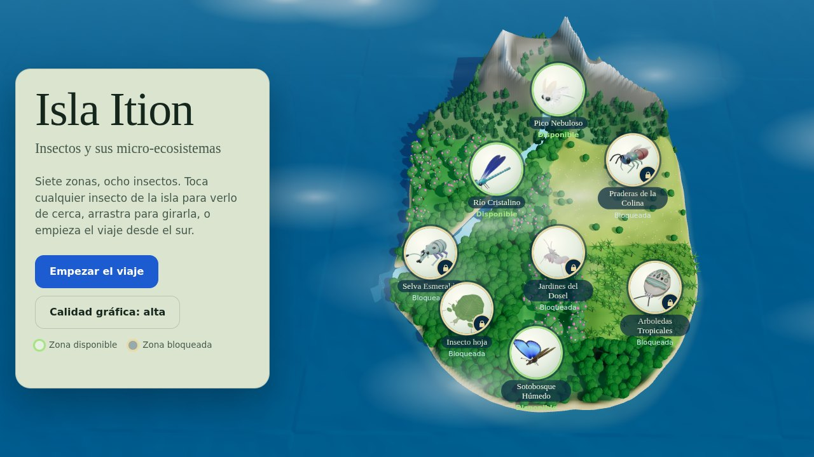
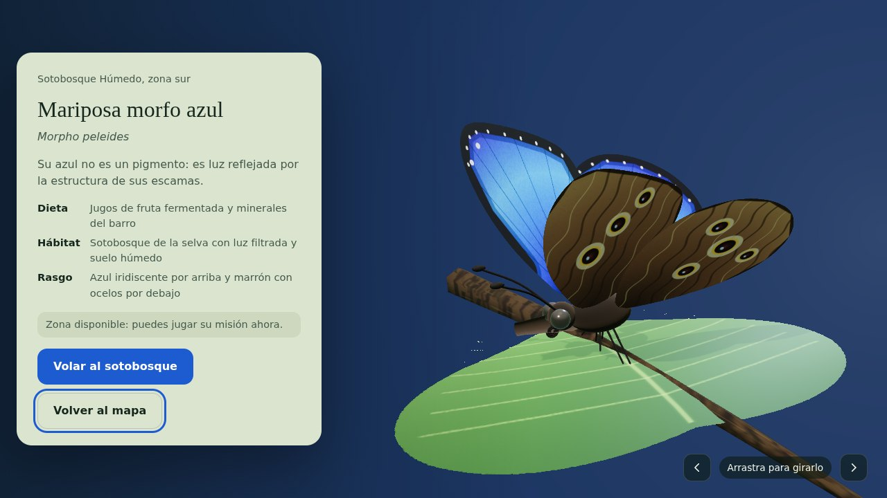
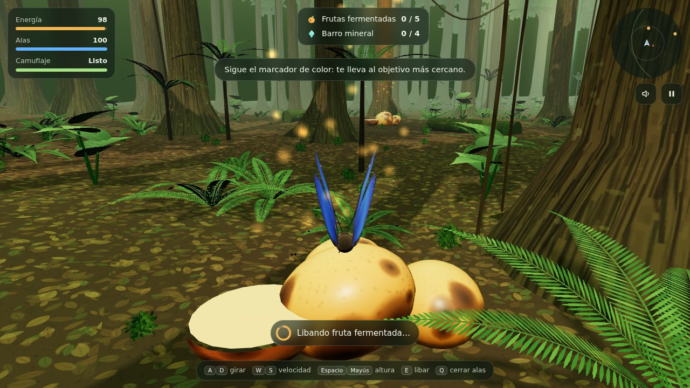
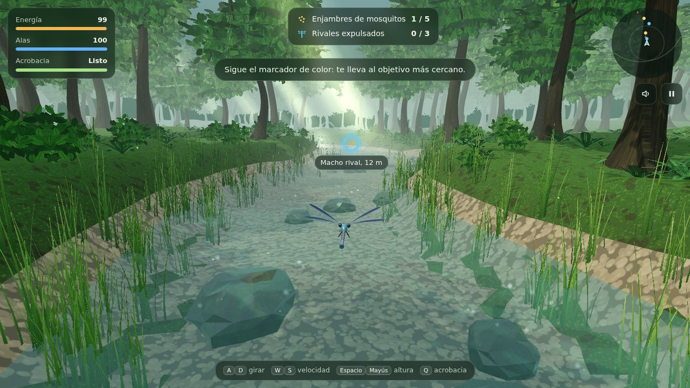
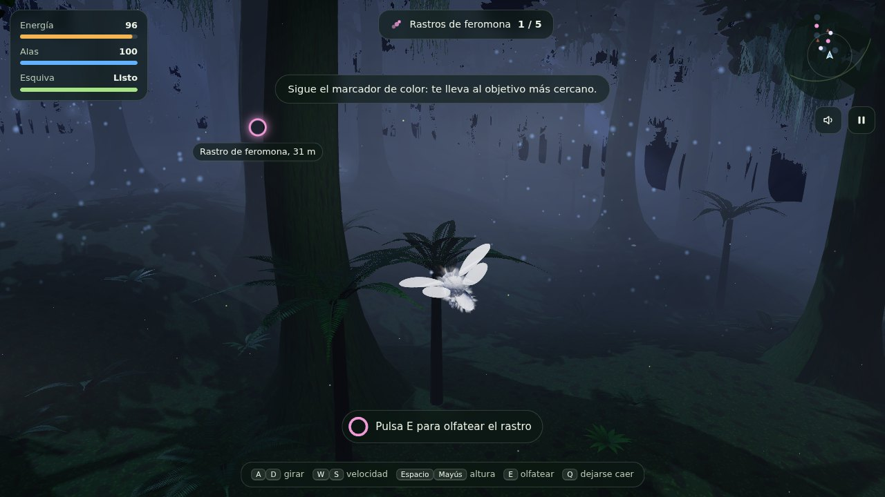

# Isla Ition: insectos y sus micro‑ecosistemas

Juego de aventura y simulación biológica en 3D para el navegador. Vuelas con el insecto de cada zona de una isla ficticia y vives su misión tal como la viviría en la naturaleza: buscar alimento, esconderse, defender su territorio o encontrar pareja.

**[▶ Jugar ahora](https://github.com/AnaSofiaBePo/isla-ition-game/)**

## La isla

Isla Ition tiene **7 zonas y 8 insectos**, ordenados de norte a sur según su hábitat real. Tres zonas ya se pueden jugar; las demás aparecen en el mapa como bloqueadas, pero sus insectos se pueden ver en la galería 3D.

| Zona | Insecto | Estado |
|---|---|---|
| Pico Nebuloso | Polilla caniche venezolana (*Artace* sp.) | Jugable |
| Río Cristalino | Dama de porcelana (*Calopteryx virgo*) | Jugable |
| Praderas de la Colina | Avispa cuco de cola rubí (*Chrysis ignita*) | Bloqueada |
| Selva Esmeralda | Gorgojo azul (*Eupholus schoenherri*) e insecto hoja (*Phyllium bioculatum*) | Bloqueada |
| Jardines del Dosel | Mantis orquídea (*Hymenopus coronatus*) | Bloqueada |
| Sotobosque Húmedo | Mariposa morfo azul (*Morpho peleides*) | Jugable |
| Arboledas Tropicales | Chinche joya Picasso (*Sphaerocoris annulus*) | Bloqueada |

Toca cualquier insecto del mapa para abrir su presentación: el modelo 3D gira sobre una rama (puedes arrastrarlo) junto a su ficha con dieta, hábitat y rasgos.

## El viaje

El recorrido va de sur a norte. En cada zona completas la misión según lo que necesita tu insecto; entonces se abre un **portal** que te lleva a la siguiente zona, donde se presenta el nuevo insecto con el que seguirás jugando.

**Sotobosque Húmedo → Río Cristalino → Pico Nebuloso**

### Sotobosque Húmedo: mariposa morfo azul

- **Misión:** liba 5 frutas fermentadas y absorbe minerales de 4 charcos de barro (el *puddling* que hacen las morfo de verdad). Después cruza el portal del santuario.
- **Peligros:** el jacamar de cola verde te ve cuando abres las alas azules; los sapos hoja esperan en las orillas del barro.
- **Habilidad:** cerrar las alas muestra su cara marrón con ocelos y te camufla.

### Río Cristalino: dama de porcelana

- **Misión:** caza 5 enjambres de mosquitos al vuelo y persigue a 3 machos rivales para expulsarlos de tu territorio. Luego llega una hembra: cortéjala con una danza aérea.
- **Peligros:** las truchas saltan a por los insectos que vuelan demasiado bajo sobre el agua.
- **Habilidad:** acrobacia, un acelerón rápido en el que nada te alcanza.

### Pico Nebuloso: polilla caniche venezolana

- **Misión:** de noche, en el bosque de niebla, olfatea con tus antenas plumosas para seguir el rastro de feromonas de la hembra a través de 5 nubes de olor, y encuéntrala en la cresta de la montaña.
- **Peligros:** murciélagos que te localizan con ondas de eco, y corrientes de aire frío que te empujan al suelo.
- **Habilidad:** dejarse caer con las alas plegadas, la maniobra real con la que muchas polillas esquivan a los murciélagos.

La polilla caniche fue fotografiada en 2009 en el Parque Nacional Canaima, en la Gran Sabana de Venezuela, y su especie todavía no se ha identificado.

## Controles

| Acción | Teclado | Pantalla táctil |
|---|---|---|
| Girar | A / D o ← / → | Círculo izquierdo |
| Acelerar y frenar | W / S o ↑ / ↓ | Círculo izquierdo |
| Subir y bajar | Espacio / Mayús | Botones Subir y Bajar |
| Libar u olfatear | E | Botón Libar u Olfatear |
| Habilidad del insecto | Q | Botón de la habilidad |
| Pausa | Esc o P | Botón de pausa |
| Silenciar | M | Botón de sonido |

Un marcador en pantalla señala siempre el objetivo más cercano, con su distancia.

## Cómo ejecutarlo

Todo el juego está en un único archivo, `index.html`.

- **En GitHub Pages:** súbelo a la raíz del repositorio y activa Pages en *Settings > Pages > Deploy from a branch > main / (root)*.
- **En tu ordenador:** abre `index.html` en un navegador moderno (Chrome, Edge, Firefox o Safari). Necesita conexión a internet para descargar el motor 3D y las fuentes.

Si va lento en tu equipo, cambia a **Calidad gráfica: baja** en el menú o en la pausa: quita sombras y reduce la vegetación y las partículas.

## Tecnología

- **Three.js r159** (WebGL), cargado desde jsDelivr.
- **Sin archivos externos de arte:** todos los modelos, texturas, terrenos y efectos se generan con código (texturas pintadas en canvas, geometría procedural y shaders propios).
- **Sonido procedural** con la Web Audio API.
- **Rendimiento:** la vegetación usa instancias, y hay dos niveles de calidad gráfica que se recuerdan en el navegador.

El código está organizado por secciones dentro de `index.html`: utilidades, sonido, texturas, shaders, modelos de insectos, un módulo por zona, el controlador de vuelo de cada especie, la misión y la interfaz, el mapa 3D y la galería. Cada zona se construye con la misma interfaz, así que añadir una nueva consiste en escribir su módulo y registrarla.

## Próximos pasos

- Construir las cuatro zonas bloqueadas: Praderas de la Colina, Selva Esmeralda, Jardines del Dosel y Arboledas Tropicales.
- Pulir el modelo de la mantis orquídea.

## Créditos

- Motor 3D: [Three.js](https://threejs.org) (licencia MIT).
- Fuentes: [Young Serif](https://fonts.google.com/specimen/Young+Serif) y [Atkinson Hyperlegible](https://fonts.google.com/specimen/Atkinson+Hyperlegible) (SIL Open Font License).
- Diseño del juego, insectos, zonas y misiones: basado en el brief de *Isla Ition*.

## Licencia

© 2026 AnaSofiaBePo. Todos los derechos reservados.

Este proyecto no es de código abierto. El código, el diseño y los contenidos se publican solo para poder jugarlo en línea. No está permitido copiarlos, modificarlos ni redistribuirlos sin permiso del autor.
